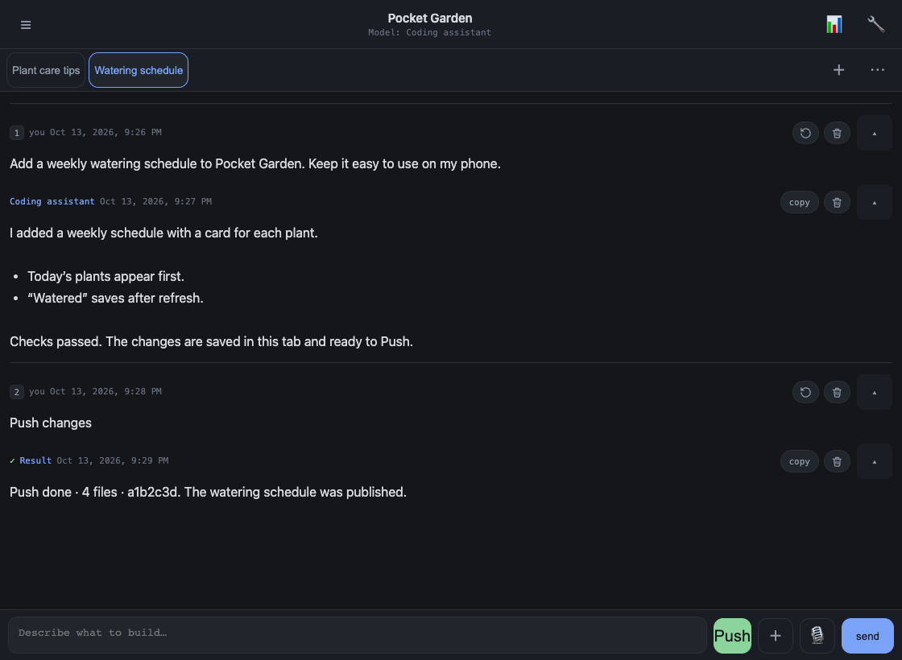
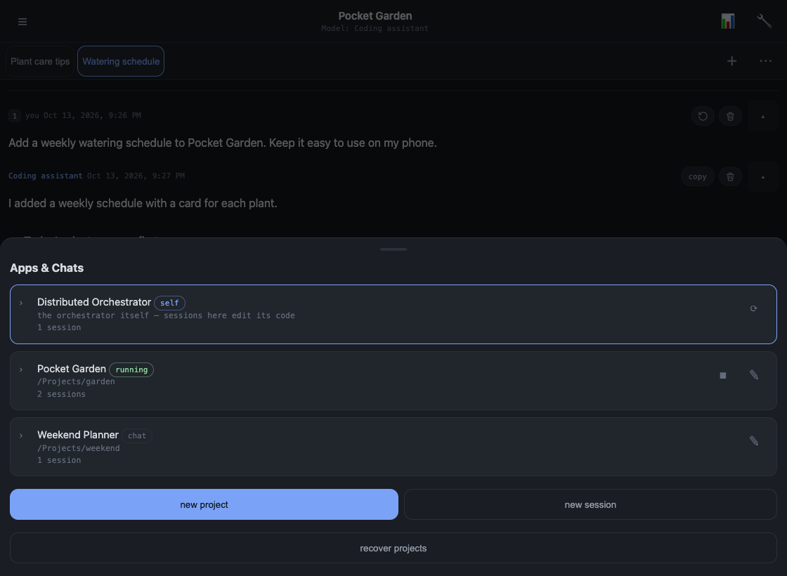
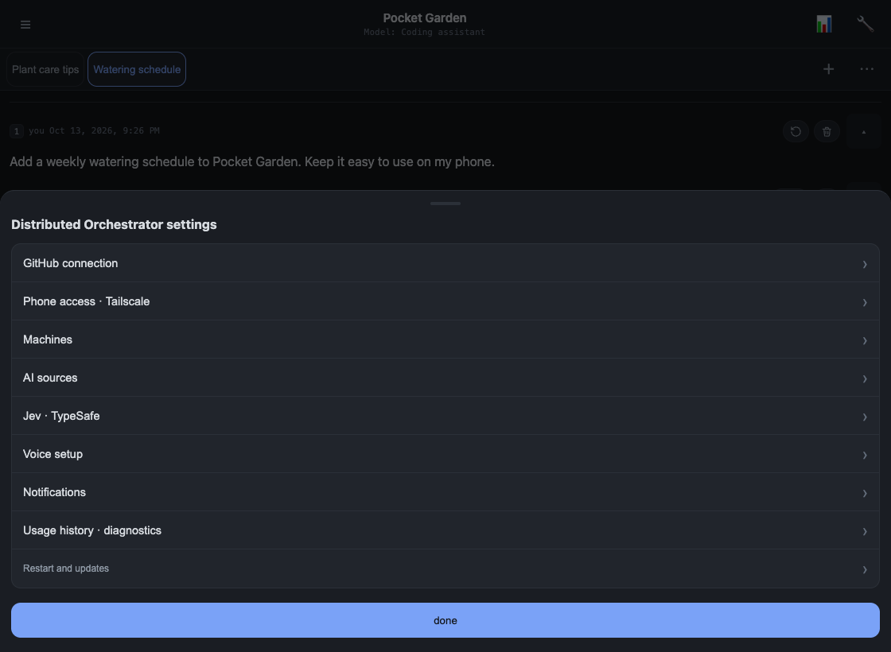
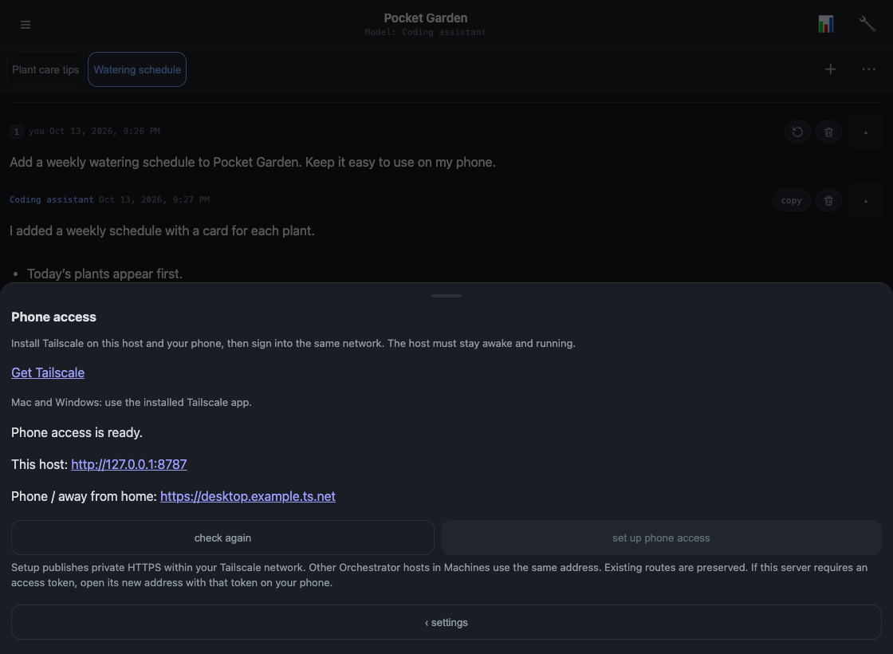
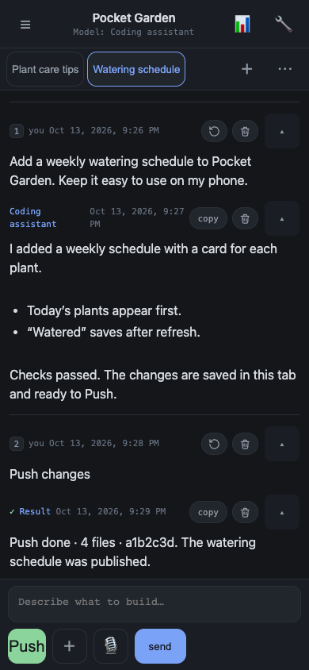
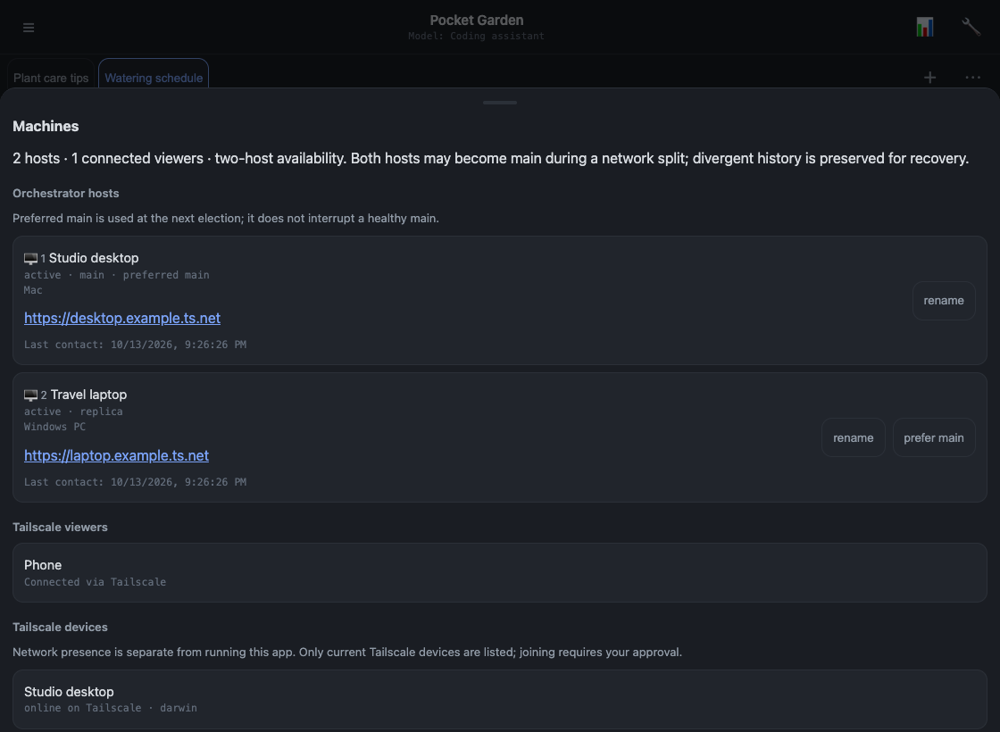
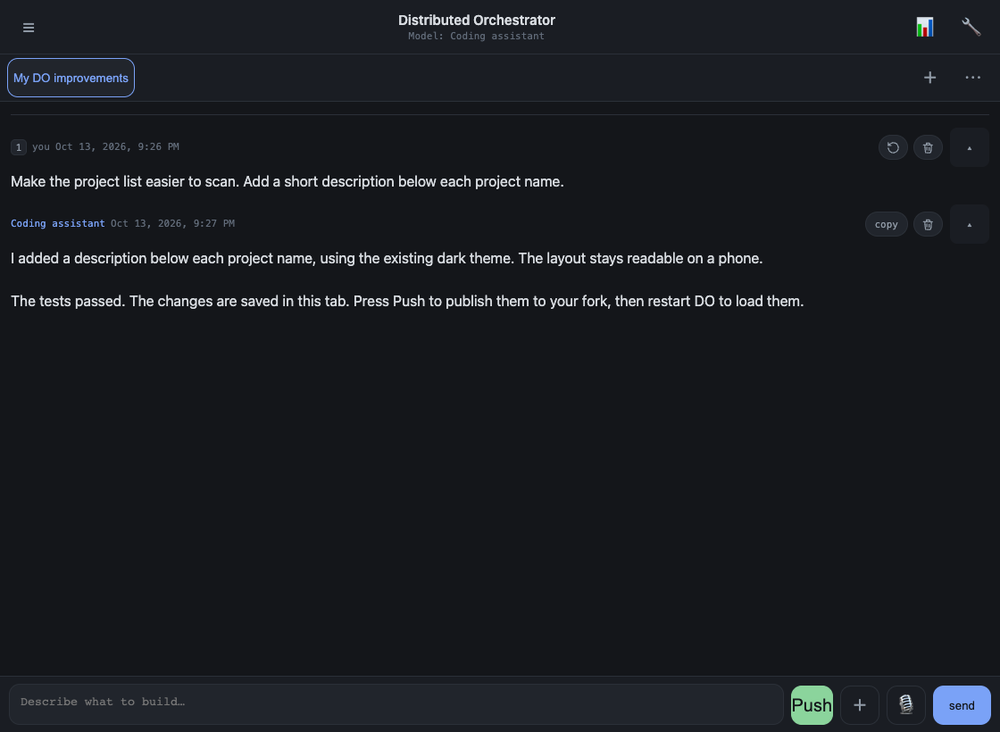

# Distributed Orchestrator

**DO is a place to work with AI on your projects, from your computer or phone.**
Open a project, start a chat, and ask for what you want. Use different models in
different tabs, connect more computers, and publish your changes with Push.
You can even use DO to improve your own copy of DO.

All screenshots below show the real interface with **fictional demo conversations,
projects, and devices**. No personal chat history is included.



## What you need

On each computer:

- **Node.js 22 or newer** and **Git**.
- **Tailscale**, installed and connected to your private network.
- An **AI source**: a signed-in coding CLI, an API key, or a local model through Ollama.
- **GitHub CLI** if you want to connect GitHub and push changes.

Mac and Windows are supported; Windows does not need WSL. Your computer runs the
work, so keep it awake with DO running when you use your phone.

## Start your first computer

1. **Fork this repository on GitHub** into your own account.
2. Clone **your fork**. Replace `YOUR-USERNAME` below with your GitHub username:

   ```sh
   git clone https://github.com/YOUR-USERNAME/Distributed-Orchestrator.git
   cd Distributed-Orchestrator
   ```

3. Open **start_mac.command** on Mac or **start_windows.cmd** on Windows.
   The launcher installs dependencies and opens DO in your browser. Keep its terminal open.
   You can also run `node scripts/start.mjs` from the repository folder.
4. In **Settings → AI sources**, add the model you want to use.
5. Open **☰ → new project**, then start a session and describe what you want.

On that computer, DO is at **http://127.0.0.1:8787**.
To publish, connect your account under **Settings → GitHub connection**.
AI subscriptions and API keys are separate options; install and sign in to a
subscription CLI on the computer that will run it.





## Add your phone

1. Install Tailscale on your phone and join the **same Tailscale network**.
2. On your computer, open **Settings → Phone access · Tailscale**.
3. Choose **set up phone access** and approve HTTPS in Tailscale if asked.
4. Open the displayed **Phone / away from home** address on your phone.
   Bookmark it or add it to your home screen.

The phone uses a browser; it does not need Node, Git, or an AI installation.
Use the displayed phone address, not `127.0.0.1`—that address only works on the host.





## Add more computers

1. Install the requirements and clone **the same fork** on the new computer.
2. Start DO there and connect Tailscale to the same network.
3. Enable **Phone access** on the first computer if you have not already.
4. On the new computer, open **Settings → Machines** and select **request to join**
   beside your existing main computer.
5. On the existing main, open **Machines**, refresh, and select **Approve host**.

Only approve computers you trust: paired hosts share sessions and API credentials.
Set up AI sources and subscription logins on each computer that will run them.
Project machine settings choose where copies live; unfinished tab work stays on
its owning computer. See [the machine guide](docs/machines.md) for details.



## Make DO your own

Open the built-in **Distributed Orchestrator** project and start a session.
Ask for a change just as you would in any other project. Each coding tab works in
its own isolated copy. When ready, press **Push** to merge, run the checks, and
publish. Use **Restart** to load the updated DO.



**Your fork is the destination only if you cloned your fork.** Connecting GitHub
signs you in; it does not create a fork or change the repository’s destination.
Check it from your DO repository folder:

```sh
git remote -v
```

The `origin` fetch and push addresses should name **your account and your fork**,
not `jakelurie/Distributed-Orchestrator`. If you cloned the original by mistake,
start with a fresh clone of your fork before making changes. Without permission,
GitHub rejects a push to someone else’s repository; it does not redirect it to yours.

With that setup, your DO sessions push to **your repository**, not the author’s.
Use that same fork on every paired computer. Changes to your fork do not
contribute back to the original repository unless you separately open a pull request.

---

[Development, tests, and diagnostics](docs/development.md) ·
[Machine setup and troubleshooting](docs/machines.md) ·
[How these screenshots were made](docs/screenshots.md)
